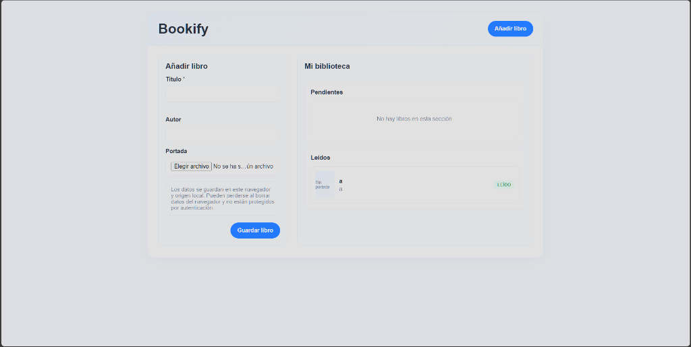
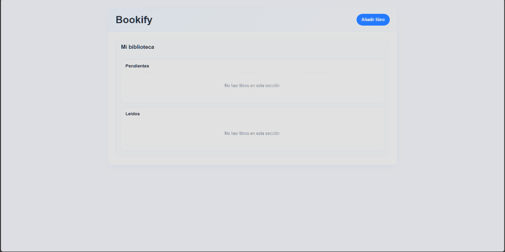
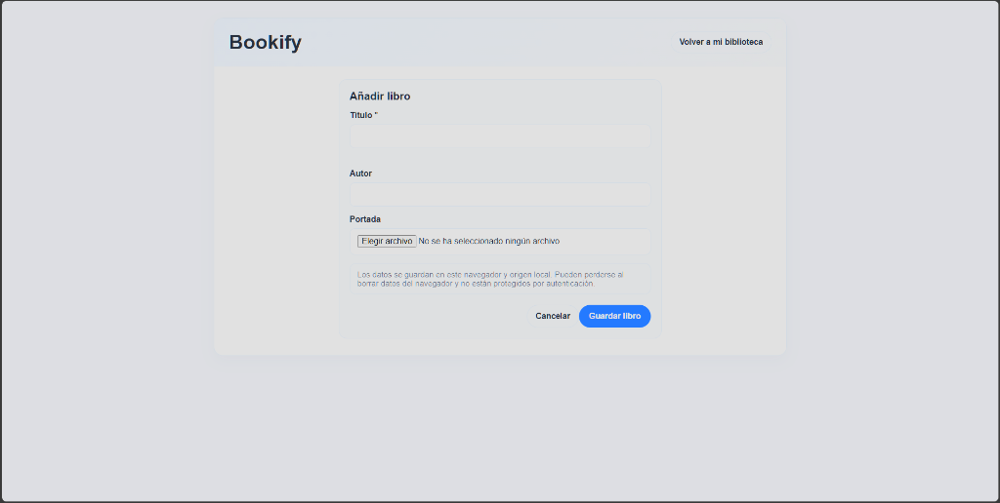

# Bookify — Repositorio de código y especificaciones

> **Aplicación web ligera para la gestión de lecturas personales (libros pendientes y leídos)**  
> Proyecto desarrollado mediante la metodología **Spec-Driven Development (SDD)** con [GitHub Spec Kit](https://github.com/github/spec-kit).

---

## Autores
* **Díaz Plaza, Míriam**
* **Jiménez Muñoz, Álvaro**
* **Bellón Payer, David**

---

## Enlaces rápidos

| Recurso | Enlace | Descripción |
| :--- | :--- | :--- |
| **Repositorio de documentación** | [github.com/MiriamDP/GitHub_Spec_SDD](https://github.com/MiriamDP/GitHub_Spec_SDD) | Memoria metodológica, análisis de fases, dificultades y presentación en PDF |
| **Presentación en Canva** | [canva.link/jiung27g8rxlw27](https://canva.link/jiung27g8rxlw27) | Diapositivas de la práctica |
| **Despliegue Vercel (rama main)** | [book-tracking-main.vercel.app](https://book-tracking-main.vercel.app) | Versión inicial (formulario y lista en dos columnas) |
| **Despliegue Vercel (rama feature)** | [book-tracking-creation-page.vercel.app](https://book-tracking-creation-page.vercel.app) | Versión evolucionada (página dedicada de alta `#/books/new`) |

---

## Funcionalidades de la aplicación

* **Añadir libros:** Registro con título obligatorio y autor opcional.
* **Portadas:** Permite adjuntar imágenes de portada (convertidas a DataURL en cliente, con validación de límite de 2 MiB para no saturar el almacenamiento).
* **Clasificación automática:** Separa dinámicamente los libros entre **Pendientes** y **Leídos**.
* **Detalle y cambio de estado:** Permite abrir la ficha de cada libro para alternar su estado de lectura o eliminarlo con confirmación previa.
* **Persistencia local:** Todos los datos se guardan en el `localStorage` del navegador, sin necesidad de servidores externos ni bases de datos remotas.

---

## Comparativa de ramas

El repositorio contiene las dos fases del desarrollo realizadas con Spec Kit:

| Rama | Interfaz y navegación | Detalles técnicos | Despliegue en Vercel |
| :--- | :--- | :--- | :--- |
| **`main`** *(MVP inicial)* | **Dos columnas integradas** | El formulario de creación se encuentra en un panel lateral dentro de `home-view.js`. Enrutamiento básico para inicio y detalle. | **[Ver en Vercel (main)](https://book-tracking-main.vercel.app)** |
| **`feature/pagina-creacion-libro`** *(Gestión del cambio)* | **Página de creación dedicada** | El formulario se desacopla en `create-view.js` accesible en la ruta `#/books/new`. La biblioteca ocupa todo el ancho principal. | **[Ver en Vercel (feature)](https://book-tracking-creation-page.vercel.app)** |

---

## Capturas de pantalla de la aplicación

### 1. Rama `main`: versión inicial en dos columnas
La vista principal integra tanto el formulario para dar de alta libros como el listado de lecturas en una misma pantalla:



---

### 2. Rama `feature/pagina-creacion-libro`: versión con cambio de requisitos
La biblioteca pasa a ocupar todo el espacio disponible y se añade el botón de acción en la cabecera:



Al pulsar en **Añadir libro**, la aplicación navega a la nueva vista dedicada centrada exclusivamente en el formulario:



---

## Estructura del proyecto y especificaciones SDD

El código y las especificaciones generadas por GitHub Spec Kit se encuentran organizados dentro de `book-tracking-app/`:

```text
tracking_books_sdd/
├── docs/
│   └── screenshots/              # Capturas de pantalla de la interfaz
└── book-tracking-app/
    ├── index.html                # Punto de entrada HTML5
    ├── package.json              # Configuración y dependencias
    ├── build.js                  # Script de empaquetado para producción (carpeta dist/)
    ├── vercel.json               # Configuración de despliegue en Vercel
    ├── server.js                 # Servidor estático local para desarrollo
    ├── src/
    │   ├── app.js                # Enrutador cliente basado en hash (#/books/...)
    │   ├── styles.css            # Estilos de la aplicación
    │   ├── model/
    │   │   └── book.js           # Entidad Book, validaciones y estados
    │   ├── persistence/
    │   │   └── book-repository.js # Adaptador para localStorage
    │   └── views/
    │       ├── home-view.js      # Vista principal de la biblioteca
    │       ├── detail-view.js    # Vista modal de detalle
    │       └── create-view.js    # Vista dedicada de creación (rama feature)
    ├── tests/
    │   ├── unit/                 # Tests unitarios del modelo y persistencia
    │   └── acceptance/           # Tests de aceptación con JSDOM
    └── specs/                    # Especificaciones generadas con GitHub Spec Kit
        ├── 001-book-reading-tracker/ # Artefactos de la versión inicial (MVP)
        │   ├── spec.md           # Requisitos funcionales e historias de usuario
        │   ├── plan.md           # Plan de arquitectura y contratos
        │   └── tasks.md          # Lista de tareas técnicas atómicas
        └── 002-book-creation-page/  # Artefactos del cambio de requisitos (rama feature)
            ├── spec.md           # Requisitos de la nueva vista desacoplada
            ├── plan.md           # Plan técnico del cambio
            ├── tasks.md          # Tareas del evolutivo
            └── checkpoints/      # Reportes de verificación de la IA
```

---

## Guía de instalación, pruebas y ejecución local

### 1. Requisitos previos
* **Node.js**: Versión 20 o superior instalada.
* **npm**: Incluido con Node.js.
* Un navegador web moderno.

### 2. Instalación de dependencias
Abre una terminal en la raíz del repositorio y entra en la carpeta de la aplicación:

```powershell
cd .\book-tracking-app
npm install
```

### 3. Ejecutar la suite de tests
Para comprobar que los modelos y los criterios de aceptación pasan las pruebas (`node:test` + `jsdom`):

```powershell
npm test
```

### 4. Compilar para producción (build)
Genera los archivos estáticos listos para producción dentro de la carpeta `dist/`:

```powershell
npm run build
```

### 5. Iniciar el servidor local
Para arrancar el servidor estático de desarrollo:

```powershell
npm start
```
Abre tu navegador en **[http://localhost:8000](http://localhost:8000)**.  
*(Consejo: mantén siempre el mismo puerto para conservar los datos guardados en el `localStorage` del navegador).*

---

## Cómo cambiar de rama en local

Para revisar y probar el código de ambas versiones desde Git:

```powershell
# Probar la versión inicial (formulario empotrado en 2 columnas):
git switch main
cd .\book-tracking-app
npm start

# Probar la versión con cambio de requisitos (página dedicada #/books/new):
git switch feature/pagina-creacion-libro
cd .\book-tracking-app
npm start
```

---

## Despliegue en producción con Vercel

Ambas ramas se han configurado para desplegarse como sitios estáticos en la red CDN de Vercel:
* `build.js` copia `index.html` y la carpeta `src/` a `dist/`.
* `vercel.json` apunta a `dist/` como directorio público.
* `.vercelignore` excluye tests, especificaciones y archivos de desarrollo del paquete final.

Para desplegar manualmente desde la CLI de Vercel:
```powershell
cd .\book-tracking-app
npx vercel deploy --prod
```
